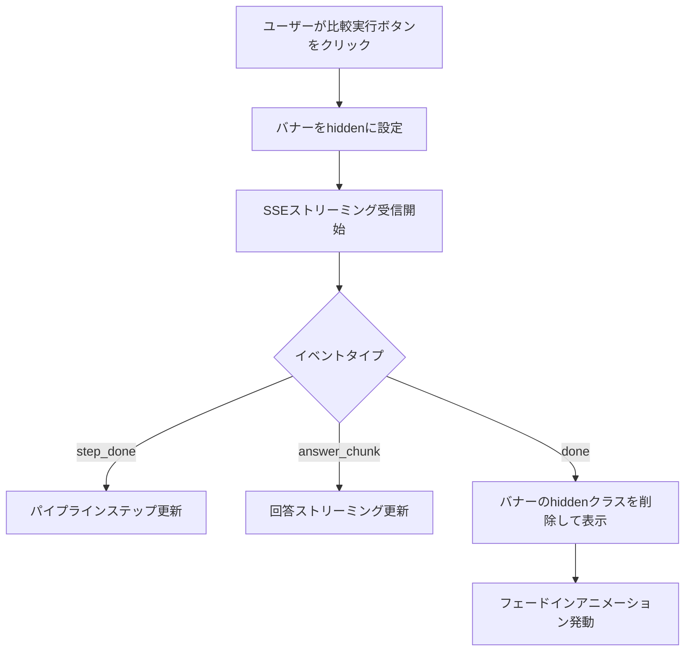

# ビジネス影響サマリーバナー実装計画

## 概要

比較デモタブの2カラム（Naive RAG / Hybrid RAG）の各パネルヘッダー直下に、ビジネス影響を1行で伝えるサマリーバナーを追加する。ITコンサルデモで「何が良くなったか」がスクロールなしで一目で分かるようにする。

## 実装ステップ

### 1. HTML変更（`app/templates/index.html`）

各比較パネルのヘッダー `<div class="bg-red-950/40 ...">` とボディ `<div id="naive-body" ...>` の間にバナー要素を挿入する。

**Naive RAG 側（左カラム）**
```html
<!-- ビジネス影響サマリーバナー -->
<div id="naive-business-summary" class="business-summary-banner business-summary-banner--risk hidden">
    <div class="business-summary-icon">❌</div>
    <div class="business-summary-content">
        <div class="business-summary-label">業務リスク</div>
        <div class="business-summary-text">他支店・旧年度の規程が混入し、誤審査の可能性あり</div>
    </div>
</div>
```

**Hybrid RAG 側（右カラム）**
```html
<!-- ビジネス影響サマリーバナー -->
<div id="hybrid-business-summary" class="business-summary-banner business-summary-banner--safe hidden">
    <div class="business-summary-icon">⭕</div>
    <div class="business-summary-content">
        <div class="business-summary-label">業務適合</div>
        <div class="business-summary-text">A社・2025年以降の現行規程のみを厳密に参照</div>
    </div>
</div>
```

### 2. CSS追加（`app/static/css/dashboard.css`）

ファイル末尾に以下のスタイルを追加する。

```css
/* ===== ビジネス影響サマリーバナー ===== */

.business-summary-banner {
    display: flex;
    align-items: flex-start;
    gap: 10px;
    padding: 12px 16px;
    border-bottom: 1px solid;
    animation: summaryFadeIn 0.4s ease forwards;
}

.business-summary-banner--risk {
    background: rgba(127, 29, 29, 0.15);
    border-bottom-color: rgba(185, 28, 28, 0.3);
}

.business-summary-banner--safe {
    background: rgba(6, 78, 59, 0.15);
    border-bottom-color: rgba(4, 120, 87, 0.3);
}

.business-summary-icon {
    font-size: 20px;
    line-height: 1;
    flex-shrink: 0;
    margin-top: 2px;
}

.business-summary-content {
    flex: 1;
    min-width: 0;
}

.business-summary-label {
    font-size: 11px;
    font-weight: 700;
    text-transform: uppercase;
    letter-spacing: 0.05em;
    margin-bottom: 2px;
}

.business-summary-banner--risk .business-summary-label {
    color: #fca5a5;
}

.business-summary-banner--safe .business-summary-label {
    color: #6ee7b7;
}

.business-summary-text {
    font-size: 14px;
    font-weight: 600;
    line-height: 1.4;
}

.business-summary-banner--risk .business-summary-text {
    color: #fecaca;
}

.business-summary-banner--safe .business-summary-text {
    color: #a7f3d0;
}

@keyframes summaryFadeIn {
    from {
        opacity: 0;
        transform: translateY(-8px);
    }
    to {
        opacity: 1;
        transform: translateY(0);
    }
}
```

### 3. JavaScript変更（`app/static/js/dashboard.js`）

検索実行時と完了時にバナーを表示/非表示にする。

**`runCompareStream()` 関数内で初期化時に隠す**
```javascript
// バナーを隠す
document.getElementById('naive-business-summary').classList.add('hidden');
document.getElementById('hybrid-business-summary').classList.add('hidden');
```

**`handleSSEEvent()` の `case 'done':` でバナーを表示**
```javascript
case 'done': {
    state.done = true;
    // ... 既存コード ...
    
    // ビジネス影響サマリーバナーを表示
    if (engine === 'naive') {
        const banner = document.getElementById('naive-business-summary');
        banner.classList.remove('hidden');
    } else {
        const banner = document.getElementById('hybrid-business-summary');
        banner.classList.remove('hidden');
    }
    break;
}
```

## 動作フロー



## 設計ポイント

1. **初期状態は非表示**: `hidden` クラスで隠し、検索が完了した時点で表示する
2. **アニメーション**: フェードイン＋スライドアップで視覚的に注目させる
3. **色分け**: リスク（赤）/ 適合（緑）で直感的に理解できる
4. **レスポンシブ**: flexboxで狭い画面でも折り返し対応
