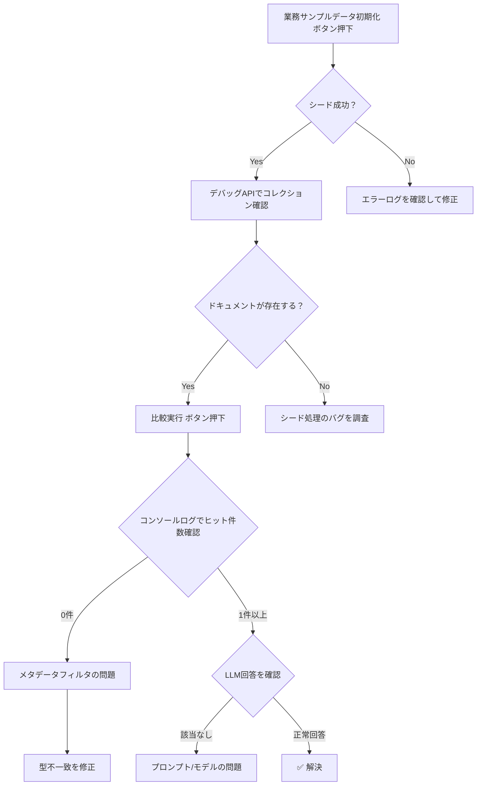

# デバッグ計画：「比較実行」ボタンで「該当する情報が参考資料に見つかりませんでした」の問題

## 問題概要

「業務サンプルデータ初期化」ボタンでデータを投入した後、「比較実行」ボタンを押すと、Naive RAG と Hybrid RAG の両方で「該当する情報が参考資料に見つかりませんでした」というメッセージが表示される。

---

## 原因分析

このメッセージは以下の2箇所のどちらかで発生します：

### 箇所A: ベクトル検索が0件返した場合
- **Hybrid RAG**: [`search_engine.py:346`](app/search_engine.py:346) → 「該当する情報が**データベース**に見つかりませんでした」
- **Naive RAG**: ChromaDB が空の場合、チャンクが空でLLMに渡される

### 箇所B: LLM の回答として生成された
- プロンプト指示（[`search_engine.py:233`](app/search_engine.py:233) / [`rag_engine.py:181`](app/rag_engine.py:181））：
  > 「参考情報に含まれていない場合は、『該当する情報が参考資料に見つかりませんでした』と回答してください。」

---

## 疑わしい原因（優先度順）

| 優先度 | 原因 | 説明 |
|--------|------|------|
| 🔴 高 | ChromaDB にデータが投入されていない | シード処理がサイレント失敗している可能性 |
| 🟡 中 | メタデータフィルタの型不一致 | `effective_year` が int vs string で比較失敗し0件ヒット |
| 🟡 中 | Ollama embedding モデルの不整合 | シード時と検索時でembeddingモデルが異なる |
| 🟢 低 | LLM が誤判断している | 参照情報は渡されているが、LLMが「該当しない」と判断 |

---

## 修正計画

### 修正1: デバッグログ追加（search_engine.py, rag_engine.py）

**目的**: ベクトル検索で何件ヒットするか、メタデータフィルタが正しく機能するかを確認する

**変更点**:
- `stream_hybrid_rag()`: メタデータフィルタ適用後のヒット件数をログ出力
- `stream_naive_rag()`: ベクトル検索結果の件数・IDをログ出力
- 0件の場合はメタデータフィルタの内容もログに含める

### 修正2: シード検証ロジック追加（seed_data.py）

**目的**: データ投入後、実際にクエリして読めるか確認する

**変更点**:
- `seed_all_data()` の最後に全件取得テストを追加
- 取得できた件数とメタデータサンプルをログ出力

### 修正3: デバッグAPIエンドポイント追加（main.py）

**目的**: ブラウザから直接コレクションの中身を覗けるようにする

**変更点**:
- `GET /api/debug/collection` エンドポイントを新規追加
- コレクションの全ドキュメント・メタデータ・件数をJSONで返す

### 修正4: フロントエンドログ強化（dashboard.js）

**目的**: SSEイベントの内容をブラウザコンソールで確認できるようにする

**変更点**:
- `handleSSEEvent()` で各イベントの詳細を `console.log` に出力
- 検索結果のチャンク数を明示的にログ出力

---

## 検証フロー

---

## 実施順序

1. **修正3** → デバッグAPIを追加してコレクション状態を確認
2. **修正1** → バックエンドにログを追加
3. **修正4** → フロントエンドにログを追加
4. **検証** → ブラウザで動作確認、ログを元に原因を特定
5. **修正2** → 必要に応じてシード処理を強化
