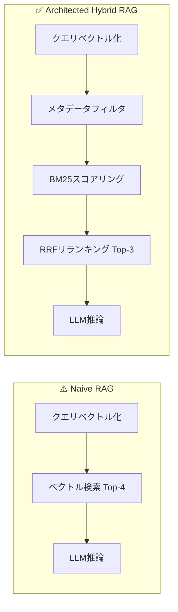

# 検索パイプライン詳細タブ 設計書

## 概要

キャプチャで示される「Naive RAG vs Architected Hybrid RAG」の比較画面を、新しいタブ「📊 検索パイプライン詳細」として追加する。各ステップの処理内容・数値の意味・考え方を詳しく説明する。

---

## タブ構成

### ① パイプライン全体フロー図（Mermaid）

Naive RAG と Hybrid RAG の検索パイプラインを並べて可視化し、各ステップの役割を説明する。

### ② 各ステップの詳細説明

#### Step 0: クエリベクトル化（両方共通）

| 項目 | 値 |
|------|-----|
| モデル | bge-m3 |
| 処理内容 | Ollama Embedding API でクエリを1024次元のベクトルに変換 |
| 所要時間 | 約3.5秒（ネットワーク＋推論） |

**考え方:** 自然言語の数値表現が_embeddingモデル_の役割。bge-m3 は日本語に強く、1024次元で高精度な類似度計算が可能。

#### Step 1: ベクトル検索（Naive RAG）vs メタデータフィルタ（Hybrid RAG）

| 比較軸 | Naive RAG | Hybrid RAG |
|--------|-----------|------------|
| 絞り込み方法 | 類似度ベース Top-4 | tenant_id + effective_year でメタフィルタ |
| 候補数 | 15 → 4件 | 15 → 8件（フィルタ後） |
| 問題点 | 別テナント・廃止規定が混入する | 対象テナントの有効規定のみ抽出 |

**考え方:** マルチテナント環境では、メタデータで事前に候補を絞り込むことが必須。Naive RAG は「類似度だけ」なので、意味的に近いけど無関係なドキュメント（別テナントの罠データ）が上位に来る。

#### Step 2: BM25 キーワードスコアリング（Hybrid RAGのみ）

| 項目 | 値 |
|------|-----|
| 形態素解析 | Janome（名詞・動詞・形容詞を抽出） |
| スコアリング | BM25Okapi（標準パラメータ k1=1.5, b=0.75） |
| 抽出語数 | クエリから約12語 |

**考え方:** ベクトル検索は「意味の近さ」を捉えるが、キーワードの正確な一致を見逃すことがある。BM25 は逆文書頻度（IDF）で希少語に重み付けし、クエリの核心語を強く反映させる。両方を組み合わせることで補完効果を得る。

#### Step 3: RRF 統合リランキング（Hybrid RAGのみ）

| 項目 | 値 |
|------|-----|
| 式 | rrf_score = 1/(k+rank_vec) + 1/(k+rank_bm25) |
| k 値 | 60（標準値） |
| 統合結果 | vec(8件) + BM25(8件) → Top-3 |

**考え方:** Reciprocal Rank Fusion は2つのランキングを融合する単純ながら強力な手法。k=60 は論文で推奨されるデフォルト値で、上位順位に大きな重みを置きつつ、下位順位も無視しないバランスを実現。各チャンクには vec#N / bm25#N のラベルと rrf_score が付与され、どの検索が寄与したか追跡可能。

#### Step 4: LLM推論（両方共通）

| 項目 | 値 |
|------|-----|
| モデル | gemma4:e4b |
| プロンプト長 | 約2000文字（参考情報＋質問＋フォーマット指示） |
| 所要時間 | 約6.4秒 |

**考え方:** 選定されたチャンクをコンテキストとしてLLMに渡し、構造化回答を生成する。Naive RAG と Hybrid RAG で同じモデル・同じプロンプトテンプレートを使用し、検索品質の差のみを比較可能にする。

### ③ 参照チャンクの比較

| 項目 | Naive RAG | Hybrid RAG |
|------|-----------|------------|
| チャンク数 | 4件 | 3件（RRF統合後） |
| スコア表示 | cosine distance のみ | vec順位 + bm25順位 + rrf_score |
| 問題 | 別テナントの罠データが混入 | 対象テナントの有効規定のみ |

**具体例:** キャプチャでは Naive RAG が「埼玉支店-確定申告書年数の緩和相談」（dist: 0.3523）を参照しているが、これはフリーランス審査とは無関係なドキュメント。Hybrid RAG はメタフィルタでこれを除外し、「入居者年収基準および家賃割安率ガイドライン」など関連性の高いチャンクを選定している。

### ④ 合計処理時間の比較

| パイプライン | 合計時間 |
|-------------|---------|
| Naive RAG | 9.98秒 |
| Hybrid RAG | 10.07秒 |

**考え方:** Hybrid RAG は追加の処理ステップ（メタフィルタ、BM25、RRF）があるが、合計時間はNaive RAGとほぼ同等。これは追加ステップがミリ秒〜数十秒レベルで軽量だから。検索精度を大幅に向上させながら、実用上の遅延は negligible。

---

## 実装方針

1. **index.html** に新しいタブボタン `data-tab="pipeline"` を追加
2. **tab-pipeline** セクションを作成し、上記内容をHTMLとして記述
3. **dashboard.js** のタブ切り替えロジックに新タブを追加（既存の active class 切り替えで対応可能）
4. Mermaid 図は `<pre>` ブロックまたは mermaid.js CDN を使用してレンダリング
