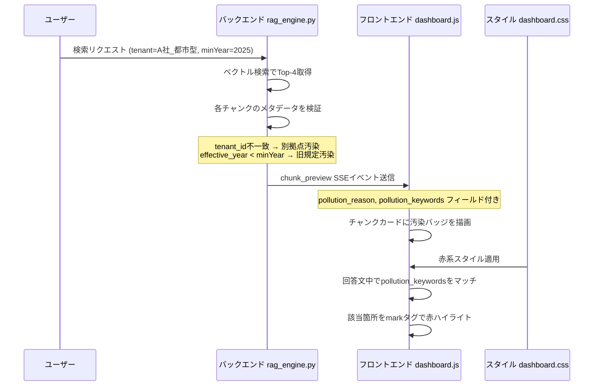

# 汚染チャンク可視化機能の実装計画

## 概要

左側（Naive RAG）で参照すべきでないチャンクが混入していることを明確に可視化する。

### 目標
1. 汚染チャンクに「❌ 汚染チャンク：別拠点のローカル特例」のようなバッジを付与
2. 回答文中でその誤情報が混ざった箇所を赤マーカーで強調

---

## データフロー図



---

## 変更ファイル一覧

### 1. `app/rag_engine.py` — バックエンド側

#### 変更箇所A: `stream_naive_rag()` 関数の chunk_preview 送信部分（約290行目）

各チャンクのメタデータを検証し、汚染判定を行う。

**追加ロジック:**
```python
# チャンクプレビュー送信前に汚染判定を追加
for i in range(len(ids_list)):
    tenant_id = metas_list[i].get("tenant_id", "")
    effective_year = metas_list[i].get("effective_year")
    
    pollution_reason = None
    pollution_keywords = []
    
    # 汚染判定ロジック
    if tenant_id != "A社_都市型":
        # 別テナントのドキュメント
        pollution_reason = f"別拠点のローカル特例（{tenant_id}）"
        # そのチャンク特有の固有名詞を抽出
        pollution_keywords = extract_pollution_keywords(docs_list[i], tenant_id)
    elif effective_year and effective_year < 2025:
        # 廃止済み旧規定
        pollution_reason = f"廃止済み旧規定（{effective_year}年）"
        pollution_keywords = extract_pollution_keywords(docs_list[i], tenant_id)
    
    preview_chunks.append({
        "id": ids_list[i],
        "title": metas_list[i].get("title", ""),
        "text_preview": text_preview,
        "distance": round(distances_list[i], 4),
        "pollution_reason": pollution_reason,
        "pollution_keywords": pollution_keywords,
    })
```

**汚染キーワード抽出関数の追加:**
```python
def extract_pollution_keywords(text: str, tenant_id: str) -> list[str]:
    """
    汚染チャンクから、回答文中で誤情報を示す可能性のある固有名詞を抽出する。
    """
    keywords = []
    # テナント名自体がキーワード
    if tenant_id and tenant_id != "A社_都市型":
        keywords.append(tenant_id)
    # 支店名などの固有名詞パターン
    import re
    branch_matches = re.findall(r'([^\s]{2,4}支店)', text)
    keywords.extend(branch_matches)
    return list(dict.fromkeys(keywords))  # 重複除去して返す
```

#### 変更箇所B: `run_naive_rag()` 関数のチャンク整形部分（約160行目）

同様の汚染判定を非ストリーミング版にも適用。

---

### 2. `app/static/js/dashboard.js` — フロントエンド側

#### 変更箇所A: `renderChunkPreviewAccordion()` 関数（約628行目）

チャンクカード描画時に `pollution_reason` をチェックし、バッジを追加。

**追加ロジック:**
```javascript
chunks.forEach((c, i) => {
    // ... 既存のヘッダー描画コード ...
    
    // 汚染バッジの追加
    if (c.pollution_reason) {
        html += `<span class="pollution-badge">❌ 汚染チャンク：${escapeHtml(c.pollution_reason)}</span>`;
    }
    
    // ... 既存のスコアバッジ描画コード ...
});
```

#### 変更箇所B: `finalizeAnswerDisplay()` 関数（約601行目）

回答文中で汚染キーワードをマッチし、赤マーカーで強調。

**追加ロジック:**
```javascript
function finalizeAnswerDisplay(container, engine, answer) {
    removeCursor(container, engine);
    const areaId = `answer-area-${engine}`;
    
    // Naive RAGの場合のみ汚染ハイライトを適用
    if (engine === 'naive') {
        answer = highlightPollutionInAnswer(answer, container);
    }
    
    // ... 既存の描画コード ...
}

function highlightPollutionInAnswer(answer, container) {
    // チャンクプレビューから汚染キーワードを取得
    const chunks = streamState.naive.answerChunks; // 既に保存されているチャンクデータ
    // pollution_keywords を集約
    const allPollutionKeywords = collectPollutionKeywords(container);
    
    allPollutionKeywords.forEach(keyword => {
        const regex = new RegExp(`(${escapeRegex(keyword)})`, 'g');
        answer = answer.replace(regex, '<mark class="pollution-marker">$1</mark>');
    });
    
    return answer;
}

function collectPollutionKeywords(container) {
    // チャンクプレビューカードから pollution_reason があるチャンクのキーワードを集約
    const keywords = [];
    // ... DOMから汚染チャンク情報を取得するロジック ...
    return keywords;
}
```

---

### 3. `app/static/css/dashboard.css` — スタイル側

#### 追加スタイル: 汚染バッジ

```css
/* ===== 汚染チャンクバッジ ===== */

.pollution-badge {
    display: inline-block;
    padding: 2px 8px;
    border-radius: 4px;
    font-size: 10px;
    font-weight: 700;
    background: rgba(185, 28, 28, 0.3);
    color: #fca5a5;
    border: 1px solid rgba(185, 28, 28, 0.5);
    margin-left: 4px;
}

/* ===== 回答文中の汚染ハイライト ===== */

.pollution-marker {
    background: rgba(239, 68, 68, 0.25);
    color: #fca5a5;
    padding: 1px 4px;
    border-radius: 3px;
    border-bottom: 2px solid #ef4444;
    font-weight: 600;
}
```

---

## 汚染判定ロジックの詳細

### 判定基準

| 条件 | 汚染種別 | バッジテキスト |
|------|---------|--------------|
| `tenant_id != "A社_都市型"` | 別拠点汚染 | `❌ 汚染チャンク：別拠点のローカル特例（{tenant_id}）` |
| `effective_year < 2025` | 旧規定汚染 | `❌ 汚染チャンク：廃止済み旧規定（{year}年）` |

### 対象ドキュメント

| ID | タイトル | tenant_id | year | 判定結果 |
|----|---------|----------|------|---------|
| doc_004 | フリーランス入居審査特例（信販系保証必須） | B社_全国賃貸 | 2026 | ❌ 別拠点汚染 |
| doc_005 | 【廃止済】旧個人事業主審査基準 | A社_都市型 | 2022 | ❌ 旧規定汚染 |
| doc_014 | 埼玉支店-確定申告書年数の緩和相談 | B社_全国賃貸 | 2026 | ❌ 別拠点汚染 |

---

## 回答文ハイライトの注意点

LLMが生成した回答文中で、汚染チャンク由来の誤情報を特定するのは完全には不可能。以下の簡易アプローチを採用：

1. **キーワードマッチング**: 汚染チャンクの `pollution_keywords`（例: 「埼玉」「B社」）を回答文中で検索
2. **正規表現置換**: 該当箇所を `<mark class="pollution-marker">` で囲む
3. **Markdownレンダリング後適用**: HTML変換後にキーワードマッチングを行う

これにより、ユーザーは「どの情報が汚染チャンクから来ているか」を視覚的に把握できる。

---

## 実装順序

1. バックエンド: `rag_engine.py` に汚染判定ロジックを追加
2. CSS: 汚染バッジ・マーカーのスタイルを追加
3. フロントエンド: チャンクカードに汚染バッジを描画
4. フロントエンド: 回答文中のハイライト機能を実装
